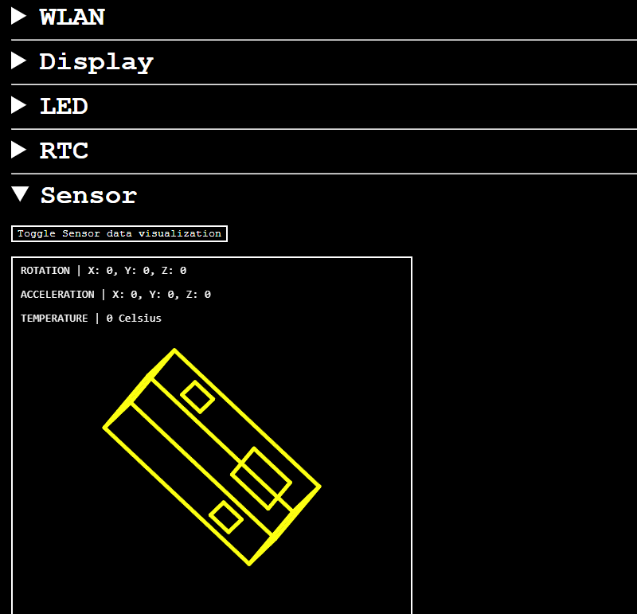

# MicroPython M5StickC Plus2 Admin

An admin web page for M5StickC Plus2 with MicroPython.

Use this as a base for your projects.



## Features

- Wi-Fi access point with an optional station connection
- LCD control: backlight, colors, text and BMP background images
- RTC configuration
- Non-blocking buzzer song player
- LED control
- 3D device visualization driven by the MPU6886:
  - accelerometer-corrected roll/pitch (no drift while still)
  - gyroscope-driven yaw
  - smooth 60 fps rendering with quaternions
  - gyro calibration and view reset
- Battery voltage and percentage (GPIO 38)
- Button A/B/C states
- I2C bus scan and raw register reads for Grove modules
- System information: firmware, CPU frequency, uptime, RAM and flash usage
- Microphone level meter (requires the optional custom PDM firmware, see
  [`firmware/pdm_rx`](firmware/pdm_rx/README.md))

## Usage

1. Flash your device with MicroPython. See more about [below](#flashing-your-device).
2. Create a local Python environment:

```bash
python3 -m venv .venv
source .venv/bin/activate
pip3 install -r requirements.txt
```

3. Use VS Code tasks or copy the files directly:

```bash
rshell --port /dev/ttyACM0 --baud 115200 cp -r cplus2_admin/* /pyboard
```

4. Boot your device if the VS Code task was not used:

```bash
rshell --port /dev/ttyACM0 --baud 115200 repl '~ import machine ~ machine.reset()'
```

5. Connect to the `M5StickC` Wi-Fi access point and open the IP shown on the
   device screen (usually `http://192.168.4.1`).

> The access point is open by default, like in previous versions. To protect
> the admin page, set `AP_PASSWORD` in
> `cplus2_admin/libs/network/wlancontroller.py` to a password with at least
> 8 characters.

## VS Code tasks

- `clear`: delete all files on the flash
- `copy`: copy all the files to the flash
- `list`: list files on flash (non recursive)
- `repl`: connect to MicroPython REPL
- `run`: run `copy` task and restart device
- `shell`: starts `rshell` shell
- `copy-mpremote`: same as `copy`, using the official `mpremote` tool
- `run-mpremote`: copy with `mpremote` and reset the device
- `repl-mpremote`: connect to the MicroPython REPL with `mpremote`

The `mpremote` tasks require `pip install mpremote`. The `rshell` tasks
remain available for compatibility.

Change port and baud rate if needed:

```json
"env": {
    "PORT": "/dev/ttyACM0",
    "BAUDRATE": "115200"
}
```

## Flashing your device

The build instructions target **MicroPython v1.29.0**, and the bundled
third-party libraries were checked against that release. The recommended
ESP-IDF version for that MicroPython release is **v5.5.2**; v5.3, v5.4,
v5.4.1, v5.4.2, v5.5.1 and v5.5.4 are also supported.

1. Clone the ESP-IDF repository and make it shell-accessible:

    ```bash
    $ git clone -b v5.5.2 --recursive https://github.com/espressif/esp-idf.git
    $ cd esp-idf
    $ ./install.sh       # (or install.bat on Windows)
    $ source export.sh   # (or export.bat on Windows)
    ```

    You will need to run `source export.sh` for every new session.

2. Clone MicroPython and checkout the supported version:

    ```bash
    $ git clone https://github.com/micropython/micropython
    $ cd ./micropython
    $ git checkout v1.29.0
    ```

3. Compile the cross compiler:

    ```bash
    $ make -C mpy-cross
    ```

4. Enter the esp32 port folder:

    ```bash
    $ cd ./ports/esp32
    ```

5. MicroPython builds for 4 MiB flashes by default. To use all the 8 MiB from
   the ESP32-PICO-V3-02 flash, change line `105` of
   `boards/sdkconfig.base` from

    ```bash
    CONFIG_ESPTOOLPY_FLASHSIZE_4MB=y
    ```

    to

    ```bash
    CONFIG_ESPTOOLPY_FLASHSIZE_8MB=y
    ```

    Keep the default partition table (`partitions-4MiBplus.csv`). On boot,
    MicroPython detects the physical flash size and creates a `vfs` partition
    from the end of the last partition to the end of flash, which gives about
    6 MiB for the filesystem. If you need OTA updates instead, use
    `partitions-8MiBplus-ota.csv`; that variant reserves two application slots
    and leaves about 3 MiB for the filesystem.

6. Compile for board `ESP32_GENERIC-SPIRAM`:

    ```bash
    $ make submodules
    $ make BOARD=ESP32_GENERIC BOARD_VARIANT=SPIRAM
    ```

    **Note**: MicroPython with the SPIRAM variant uses the PSRAM as available
    RAM. This increases the RAM to 2 MiB, however it is slower than the 520 KiB
    SRAM. If you need more speed, remove `BOARD_VARIANT=SPIRAM` from all
    commands, but some functions will not work due to the buffer size needed.

7. Flash the device (change the port if needed):

    ```bash
    $ make PORT=/dev/ttyACM0 erase
    $ make BOARD=ESP32_GENERIC BOARD_VARIANT=SPIRAM PORT=/dev/ttyACM0 deploy
    ```

## HTTP API

All endpoints return JSON in the `{"message": ..., "result": ...}` format.

| Method | Path | Description |
| --- | --- | --- |
| GET | `/api/ap` | Access point information |
| GET | `/api/sta` | Station information (`null` when disconnected) |
| GET | `/api/wlan` | Scan available networks |
| POST | `/api/wlan/connect` | Connect to a network (`ssid`, `password`; `password` may be `null`) |
| GET | `/api/rtc` | Read the RTC |
| POST | `/api/rtc` | Set the RTC |
| GET | `/api/display/backlight/toggle` | Toggle the LCD backlight |
| POST | `/api/display/background/color` | Set the background color (`r`, `g`, `b`) |
| POST | `/api/display/background/image` | Set a base64 BMP background (`file`) |
| POST | `/api/display/foreground/color` | Set the text color (`r`, `g`, `b`) |
| POST | `/api/display/text` | Write text on the LCD (`text`) |
| GET | `/api/led/toggle` | Toggle the red LED / IR emitter |
| GET | `/api/buzzer` | Buzzer playback status |
| POST | `/api/buzzer` | Play notes (`bpm`, `step`, `notes`) |
| GET/POST | `/api/buzzer/stop` | Stop playback |
| GET | `/api/sensor` | Combined accelerometer, gyroscope and temperature sample |
| GET | `/api/sensor/acceleration` | Accelerometer only |
| GET | `/api/sensor/rotation` | Gyroscope only (deg/s) |
| GET | `/api/sensor/temperature` | MPU6886 die temperature |
| POST | `/api/sensor/calibrate` | Calibrate the gyro zero-rate offset (keep still) |
| GET | `/api/battery` | Battery voltage and percentage |
| GET | `/api/system` | Firmware, CPU, uptime, RAM, flash and button states |
| GET | `/api/buttons` | Button A/B/C states |
| GET | `/api/i2c/scan` | Scan the I2C bus for connected devices |
| GET | `/api/i2c/read` | Read up to 32 registers (`address`, `register`, `length`) |
| GET | `/api/microphone/level` | Peak/RMS of a short PDM recording (custom firmware only) |

The combined sensor sample is the one used by the 3D visualization:

```json
{
  "accel": {"x": 0.01, "y": 0.00, "z": 1.00},
  "gyro": {"x": 0.12, "y": -0.03, "z": 0.00},
  "temperature": 27.4,
  "units": {"accel": "g", "gyro": "deg/s", "temperature": "C"},
  "ticks_ms": 123456
}
```

## Known limitations

- **Microphone**: the SPM1423 is a PDM microphone (clock on GPIO 0, data on
  GPIO 34). Stock MicroPython v1.29.0 still does not expose PDM receive through
  `machine.I2S`. The experimental patch and a prebuilt firmware are available
  in [`firmware/pdm_rx`](firmware/pdm_rx/README.md); without it the admin page
  reports that the microphone is unavailable instead of failing.
- **IR emitter**: it shares GPIO 19 with the red LED. It can be toggled through
  the LED endpoint, but there is no IR protocol implementation.
- **Yaw**: the MPU6886 has no magnetometer, so yaw is relative and can drift.
  Use *Calibrate gyro* with the device still and *Reset view* to re-center it.
- **Grove sensors**: the I2C bus can be scanned and registers can be read with
  `/api/i2c/read`, but drivers for external Grove modules are not included.

## Credits

The following modules are derived from third-party sources:

- `colors`: from https://github.com/gandro/micropython-m5stickc-plus
- `logging`: from https://github.com/micropython/micropython-lib
- `mpu6886`: from https://github.com/tuupola/micropython-mpu6886
- `pcf8563`: from https://github.com/gandro/micropython-m5stickc-plus
- `st7789`: from https://github.com/gandro/micropython-m5stickc-plus
- `time`: from https://github.com/micropython/micropython-lib
- `tinyweb`: from https://github.com/belyalov/tinyweb

The original license headers are preserved in each file. See
[THIRD_PARTY_NOTICES.md](THIRD_PARTY_NOTICES.md) for details.

## License

This project is licensed under the MIT License. See [LICENSE](LICENSE).
